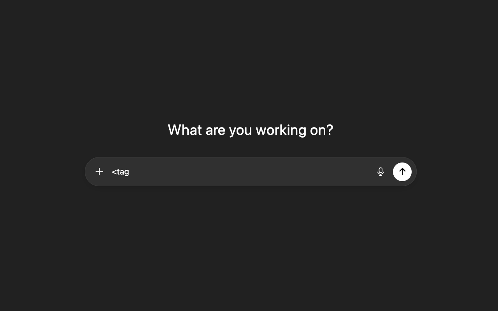
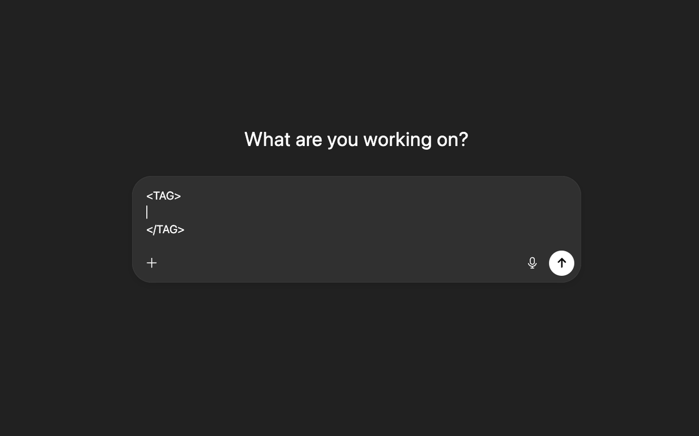

  

# Auto Close Tag for ChatGPT

[日本語](README.md)

Auto Close Tag for ChatGPT is a Chrome extension that adds the closing `</tag>` when you type `<tag>` in the ChatGPT composer.

It makes it quick to split a prompt into sections with XML-like tags such as `<instruction_spec>`, a structure OpenAI's prompting guides recommend (see [References](#references)).

## Features

- **Closes the tag when you type `>`.** Works with attributes such as `<tag id="">`. Skips it when the same closing tag already follows.
- **Adds a blank line between the tags.** The caret moves to that line. Can be turned off in the options (on by default).
- **Uppercases English tag names.** Both the opening and closing tags. Can be turned off in the options (on by default).
- **Backspace removes the matching closing tag too.**
- **Knows when not to complete.** Void tags such as `br` and `img`, self-closing `<tag/>`, and text still in IME conversion are left alone.

## Example

While typing:

  

After typing `>` (the closing tag is added and the caret moves to the blank line):

  

## Requirements

| What | Used for |
| --- | --- |
| Google Chrome (a Manifest V3 version) | Running the extension |
| ChatGPT (`chatgpt.com` or `chat.openai.com`) | The composer where completion works |

## Installation

Load it from source.

1. Clone this repository, or download and extract the ZIP.
2. Turn on **Developer mode** in `chrome://extensions`.
3. Click **Load unpacked** and select the folder.

## Usage

1. Open ChatGPT.
2. Type `<tag>` in the composer and `</tag>` is added.

| When | Do this |
| --- | --- |
| You do not want the blank line or uppercasing | Turn each off in the extension options |
| You do not want a closing tag | Write a self-closing `<tag/>`, or type the closing tag first |

## Limitations

- Works only in the ChatGPT composer. Not on other sites, in the address bar, the Chrome Web Store, or inside other extensions.
- Does not fix or check text whose tags are already mismatched.

## Development

There is no build step. After editing, reload the extension in `chrome://extensions`.

Background and decisions are in [docs/design.md](docs/design.md), and manual test steps in [docs/TESTING.md](docs/TESTING.md) (both Japanese).

## References

- [OpenAI "GPT-5 for Coding Cheatsheet"](https://cdn.openai.com/API/docs/gpt-5-for-coding-cheatsheet.pdf): recommends structuring instructions with XML-like syntax
- [OpenAI "GPT-5 Prompting Guide"](https://cookbook.openai.com/examples/gpt-5/gpt-5_prompting_guide): structured prompting and insights from Cursor

## License

[MIT](LICENSE)
