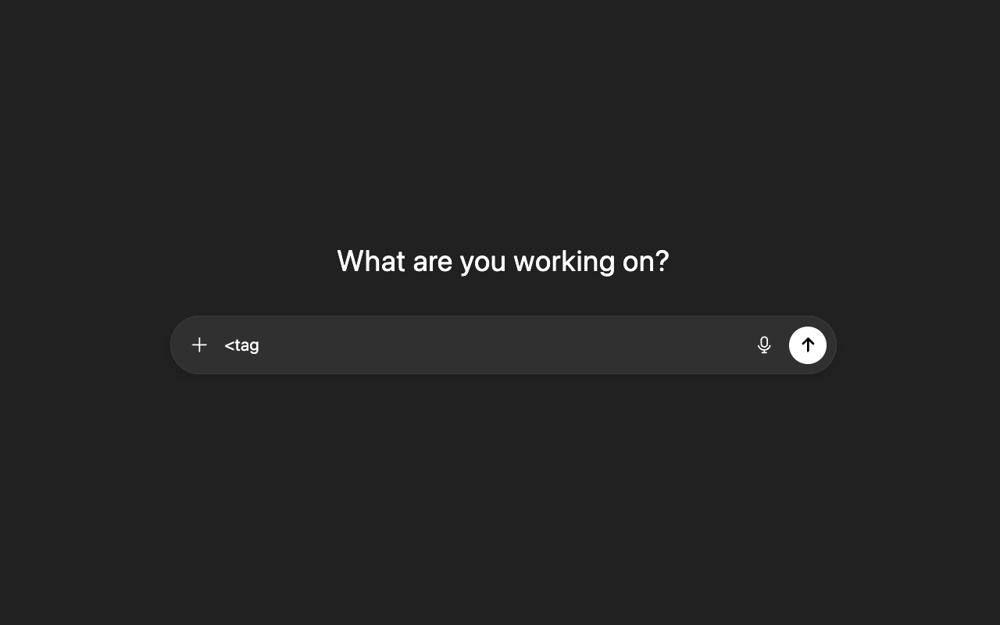
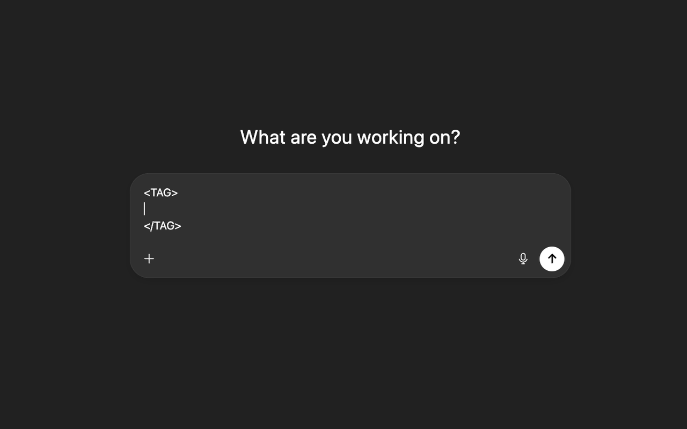

  

# Auto Close Tag for ChatGPT

[English](README.en.md)

Auto Close Tag for ChatGPT は、ChatGPT の入力欄で `<tag>` と打つと、閉じタグ `</tag>` を自動で補う Chrome 拡張です。

`<instruction_spec>` のような XML 風のタグでプロンプトを区切る書き方を、手早くできるようにします。OpenAI のプロンプトの手引きは、指示をこの形で構造化することを勧めています（[参考](#参考)）。

## 特徴

- **`>` を打った時点で閉じタグを足す。** `<tag id="">` のように属性があっても補います。直後に同じ閉じタグがあるときは足しません。
- **開きタグと閉じタグの間に改行を入れる。** カーソルは間の空行に移ります。設定で切れます（既定はオン）。
- **英字のタグ名を大文字にする。** 開きタグと閉じタグの両方を大文字にします。設定で切れます（既定はオン）。
- **Backspace で対になる閉じタグも消す。**
- **補わない場面を分ける。** `br` や `img` のような閉じタグの要らないタグ、`<tag/>` のような自己終了の書き方、日本語入力の変換中は補いません。

## 画面例

入力中:

  

`>` を打った後（閉じタグが入り、カーソルが間の空行に移る）:

  

## 動作環境

| 必要なもの | 用途 |
| --- | --- |
| Google Chrome（Manifest V3 に対応した版） | 拡張の実行 |
| ChatGPT（`chatgpt.com` か `chat.openai.com`） | 補完が働く入力欄 |

## インストール

ソースから読み込みます。

1. このリポジトリを clone するか、ZIP で取得して展開します。
2. `chrome://extensions` で「デベロッパー モード」をオンにします。
3. 「パッケージ化されていない拡張機能を読み込む」で、取得したフォルダを選びます。

## 使い方

1. ChatGPT を開きます。
2. 入力欄で `<tag>` と打つと、`</tag>` が入ります。

| こんなとき | こうする |
| --- | --- |
| 改行や大文字化が要らない | 拡張のオプション画面で、それぞれをオフにする |
| 閉じタグを補わせたくない | `<tag/>` のように自己終了で書くか、閉じタグを先に打っておく |

## できないこと

- ChatGPT の入力欄でしか働きません。ほかのサイト、アドレスバー、Chrome ウェブストア、ほかの拡張の中では補いません。
- タグの対応が崩れた文章を直したり、検査したりはしません。

## 開発

ビルドの手順はありません。ファイルを直したら、`chrome://extensions` で拡張を再読み込みします。

背景と判断は [設計](docs/design.md)、手動で確かめる手順は [テストガイド](docs/TESTING.md) にあります。

## 参考

- [OpenAI「GPT-5 for Coding Cheatsheet」](https://cdn.openai.com/API/docs/gpt-5-for-coding-cheatsheet.pdf): 指示を XML 風の書き方で構造化することを勧めている
- [OpenAI「GPT-5 Prompting Guide」](https://cookbook.openai.com/examples/gpt-5/gpt-5_prompting_guide): 構造化したプロンプトの書き方と、Cursor での知見

## ライセンス

[MIT](LICENSE)
